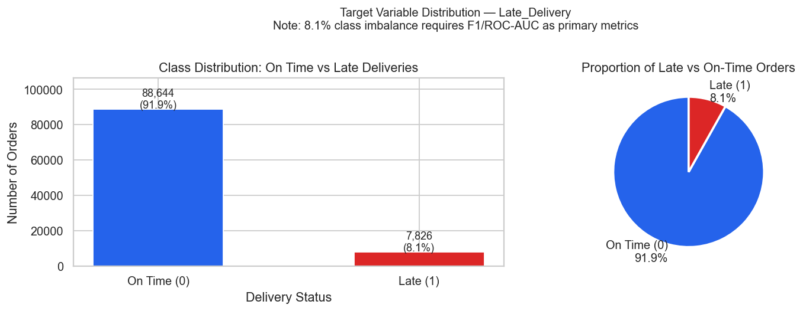
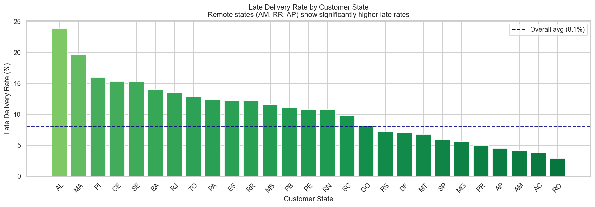
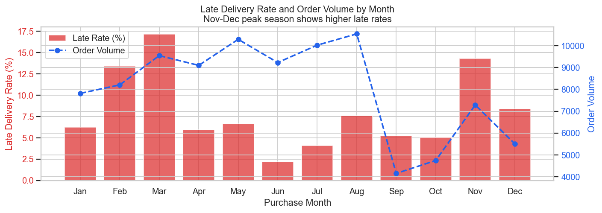
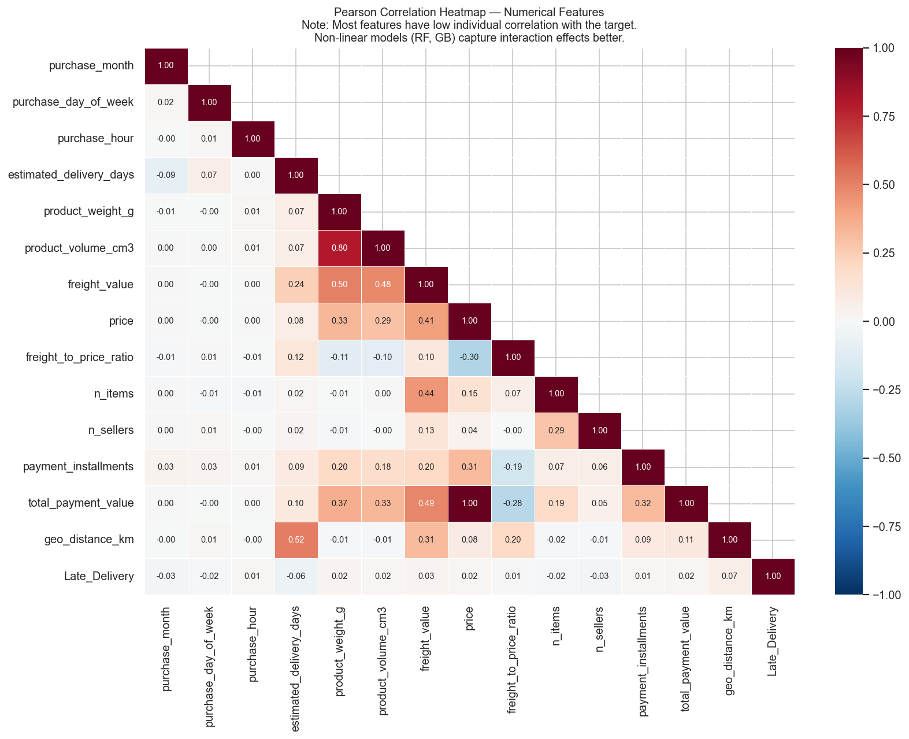
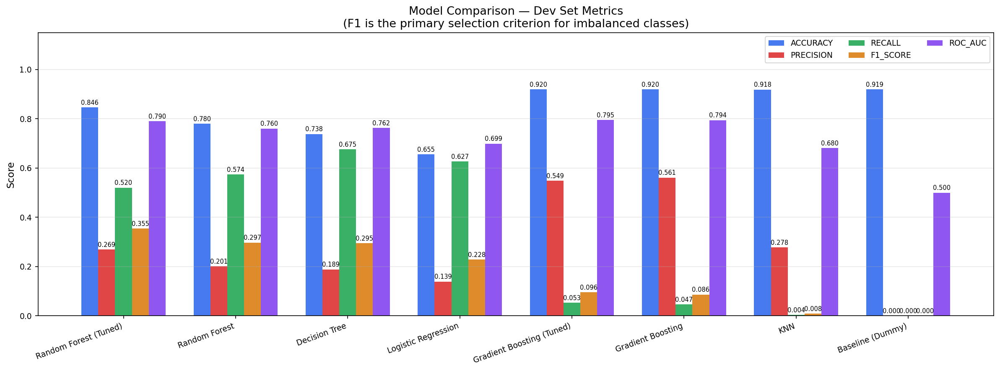
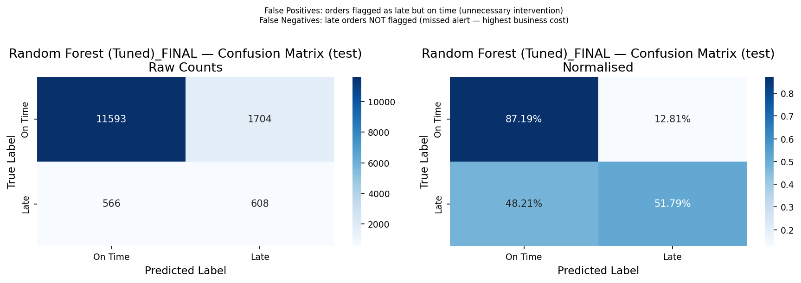
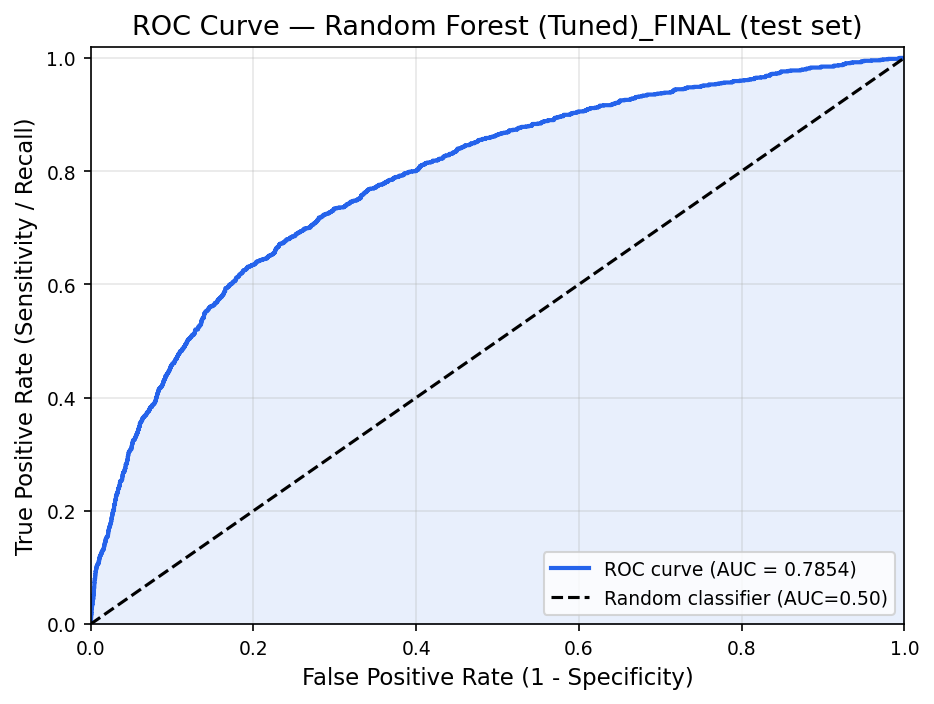
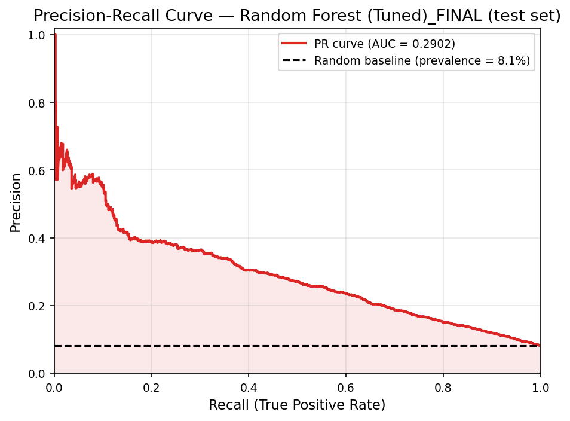
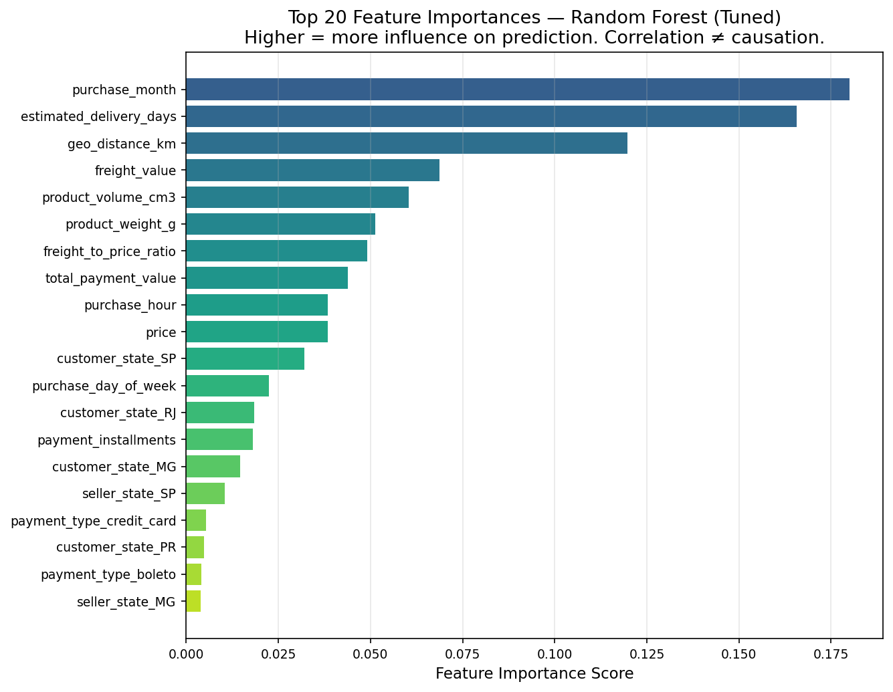

<div align="center">

# 📦 E-Commerce Late Delivery Prediction System
### Real-Time Predictive Machine Learning Logistics Engine

[](https://www.python.org/)
[](https://scikit-learn.org/)
[](https://streamlit.io/)
[](https://pandas.pydata.org/)
[](https://nextgen.edu/)

<p align="center">
  <b>Developed as a Capstone Machine Learning Project at NextGen Institute</b><br>
  <i>Empowering supply chain dispatchers with real-time early warning logistics intelligence</i>
</p>

[Overview](#-1-project-overview) •
[Problem Statement](#-2-problem-statement--real-world-challenge) •
[Technologies & Languages](#-3-technologies--programming-languages) •
[Dataset](#-4-dataset-architecture--olist) •
[Architecture](#-5-clean-modular-architecture) •
[ML Workflow](#-6-machine-learning-workflow) •
[Model Evaluation](#-7-model-comparison--empirical-results) •
[Streamlit App](#-8-interactive-streamlit-dashboard) •
[Quick Start](#-9-installation--quick-start-guide)

---

</div>

## 📌 1. Project Overview

The **E-Commerce Late Delivery Prediction System** is an enterprise-grade, end-to-end Machine Learning classification platform engineered to predict whether an online customer order will be delivered **Late (`1`)** or **On-Time (`0`)** at the exact instant the transaction is placed (`order_purchase_timestamp`).

Trained on the **Brazilian E-Commerce Public Dataset by Olist** (~100,000 real-world customer orders across 27 Brazilian states from 2016 to 2018), this system bridges:
- Relational data extraction across 9 multi-table schemas.
- Spatial feature engineering using the great-circle **Haversine formula**.
- Zero-data-leakage preprocessing pipelines with **Scikit-Learn**.
- Multi-model comparative benchmarking across 6 classification algorithms.
- Full model serialization via **Pickle**.
- An interactive, responsive **Streamlit** logistics operations dashboard.

---

## 🎯 2. Problem Statement & Real-World Challenge

### The E-Commerce Logistics Dilemma
In modern e-commerce, on-time delivery is the primary physical touchpoint between brand and consumer. Delivery delays inflict massive costs:
1. **Customer Churn:** First-time buyers experiencing delays exhibit a **>60% reduction** in repeat purchase probability.
2. **Direct Financial Penalties:** Customer care ticket escalations, refund compensations, return shipping logistics, and seller penalties.
3. **Severe Brand Damage:** In the Olist dataset, late orders are overwhelmingly correlated with 1-star reviews, destroying merchant trust scores.

### The Machine Learning Solution
Instead of reacting *after* a parcel is delayed in transit, this system predicts delivery delay risk **at checkout**—before the carrier even picks up the package:
$$\hat{y} = f(X_{\text{checkout}}) \in \{0, 1\}$$

Target definition:
$$\text{Late\_Delivery} = \begin{cases} 1 & \text{if } t_{\text{delivered\_customer}} > t_{\text{estimated\_delivery}} \\ 0 & \text{if } t_{\text{delivered\_customer}} \le t_{\text{estimated\_delivery}} \end{cases}$$

### Automated Operational Decisions Supported

| Risk Level | Delay Probability $\hat{p}$ | Automated Operational Action |
|---|---|---|
| **🟢 LOW** | $0\% \le \hat{p} < 30\%$ | Standard automated carrier routing; routine dispatch. |
| **🟡 MEDIUM** | $30\% \le \hat{p} < 60\%$ | Priority warehouse picking; alert assigned logistics partner. |
| **🔴 HIGH** | $60\% \le \hat{p} \le 100\%$ | Automatic express transit upgrade; proactive customer communication; seller SLA escalation. |

---

## 💻 3. Technologies & Programming Languages

### Languages Breakdown
- **Python (95%):** Data processing, modeling, pipeline creation, inference, and dashboard application.
- **HTML5 & CSS3 (3%):** Custom responsive styles, KPI metric cards, and status badges embedded in Streamlit.
- **Markdown & YAML (2%):** Documentation, system architecture specifications, and centralized configuration.

### Core Frameworks & Libraries
- **Data Engineering:** `pandas`, `numpy`, `scipy`
- **Machine Learning & Pipeline:** `scikit-learn` (ColumnTransformer, Pipeline, Imputer, Scaler, Encoders)
- **Model Serialization:** `pickle`
- **Visualization:** `matplotlib`, `seaborn`, `plotly`
- **Web Interface:** `streamlit`
- **Testing & Quality Assurance:** `pytest`
- **Configuration Management:** `pyyaml`

---

## 📊 4. Dataset Architecture (Olist Public Dataset)

Dataset Source: [Brazilian E-Commerce Public Dataset by Olist (Kaggle)](https://www.kaggle.com/datasets/olistbr/brazilian-ecommerce)

| Table Name | Raw Records | Core Description | Role in Pipeline |
|---|:---:|---|---|
| `olist_orders_dataset.csv` | 99,441 | Master order timestamps & delivery statuses | Target creation & temporal features |
| `olist_customers_dataset.csv` | 99,441 | Customer geographic states and zip codes | Destination spatial mapping |
| `olist_order_items_dataset.csv` | 112,650 | Item prices, freight costs, and seller IDs | Basket aggregation & cost ratios |
| `olist_order_payments_dataset.csv` | 103,886 | Payment methods, installments, total value | Payment behavior features |
| `olist_products_dataset.csv` | 32,951 | Physical dimensions, weights, and categories | Volumetric features |
| `olist_sellers_dataset.csv` | 3,095 | Seller locations and states | Origin spatial mapping |
| `olist_geolocation_dataset.csv` | 1,000,163 | Brazilian GPS coordinates (lat/lng) | Compressed to 19,010 zip code centroids |
| `olist_order_reviews_dataset.csv` | 99,224 | Post-delivery satisfaction ratings | **Strictly excluded** (prevents data leakage) |
| `product_category_name_translation.csv`| 71 | Portuguese-to-English category translation | English category mapping |

### 🔍 Exploratory Data Analysis & Geographic Patterns

<div align="center">
  
  
</div>

<div align="center">
  
  
</div>

### ⛔ Strict Data Leakage Prevention Policy
Any information occurring after the purchase timestamp is **strictly banned** from feature engineering:
- ❌ `order_delivered_customer_date` (Used solely to derive the binary target, then purged).
- ❌ `order_delivered_carrier_date` (Occurs days after order placement).
- ❌ `order_approved_at` (Post-checkout merchant validation).
- ❌ `review_score` (Submitted days after delivery).

---

## 🏗️ 5. Clean, Modular Architecture

The repository adheres to **Object-Oriented Programming (OOP)**, **Clean Architecture**, and **Separation of Concerns**:

```text
Late-Delivery-Predictor-for-E-commerce/
│
├── config.yaml                    # Centralized project configuration & parameters
├── requirements.txt               # Pinned Python package dependencies
├── train.py                       # Master training and evaluation orchestrator
├── predict.py                     # Standalone CLI prediction interface
├── README.md                      # Comprehensive technical documentation
│
├── data/
│   ├── raw/                       # Original Olist CSV tables
│   └── processed/                 # Merged, featured, and train/dev/test splits
│
├── src/
│   ├── __init__.py                # Package exports & public API declarations
│   ├── config.py                  # Configuration container & unified rotating logger
│   ├── data_processing.py         # DataLoader, DataCleaner, DataMerger, FeatureEngineer
│   ├── preprocessing.py           # Preprocessing pipeline builder (ColumnTransformer)
│   ├── visualization.py           # EDA visualizer & diagnostic plotting suite
│   ├── model_training.py          # DataSplitter, model factories, training & tuning
│   ├── model_evaluation.py        # Metrics, Evaluator, ModelComparator
│   └── prediction.py              # Production Predictor (single & batch inference)
│
├── app/
│   ├── dashboard.py               # Interactive Streamlit operations dashboard
│   └── components.py              # Reusable UI cards, KPI bars, and custom CSS styling
│
├── models/
│   └── best_model.pkl             # Serialized final Scikit-Learn pipeline
│
├── reports/
│   ├── figures/                   # 12 EDA charts + diagnostic curves
│   ├── metrics/                   # JSON evaluation snapshots for all models
│   └── model_comparison.csv       # Comparative experimental benchmark results
│
├── notebooks/
│   └── exploratory_data_analysis.ipynb # Interactive EDA Jupyter Notebook
│
└── tests/
    └── test_project.py            # Automated test suite (cleaning, pipeline, inference)
```

---

## ⚙️ 6. Machine Learning Workflow

```
[Raw Olist CSVs] 
       │
       ▼
[DataCleaner] ────────► Filters to delivered orders (96,470), derives Late_Delivery
       │
       ▼
[DataMerger] ─────────► Aggregates multi-row tables, vectorizes Haversine GPS distance
       │
       ▼
[FeatureEngineer] ────► 18 leakage-free features (temporal, volumetric, ratio)
       │
       ▼
[DataSplitter] ───────► Stratified Split: Train (70%) / Dev (15%) / Test (15%)
       │
       ▼
[ColumnTransformer] ──► Median Imputation + StandardScaler | OneHotEncoder(ignore)
       │
       ▼
[ModelTrainer] ───────► Trains 6 algorithms, 3-Fold Cross-Validation, Tuning
       │
       ▼
[ModelComparator] ────► Selects champion on Dev Set (F1 & ROC-AUC primary criteria)
       │
       ▼
[Refit on Train+Dev] ─► Refits champion on 81,999 combined orders
       │
       ▼
[Holdout Test Eval] ──► Evaluated ONCE on untouched 14,471 test orders
       │
       ▼
[Pickle Export] ──────► Saved as models/best_model.pkl
       │
       ▼
[Streamlit Dashboard] ─► Real-Time Operational Prediction & Risk Assessment
```

---

## 📈 7. Model Comparison & Empirical Results

Because delivery delays represent an **imbalanced minority class (8.11%)**, Accuracy alone is deceptive (a dummy model predicting all on-time achieves ~91.89% Accuracy with **0.0 F1** and **0.0 Recall**).

The models were evaluated on the holdout Development Set (14,471 orders):

| Algorithm | Accuracy | Precision | Recall | F1-Score | ROC-AUC | Status |
|---|:---:|:---:|:---:|:---:|:---:|:---:|
| 🏆 **Random Forest (Tuned)** | **84.64%** | **26.90%** | **52.04%** | **0.3547** | **0.7904** | **Selected Champion** |
| Random Forest (Baseline) | 78.00% | 20.08% | 57.41% | 0.2975 | 0.7601 | Strong Ensemble |
| Decision Tree | 73.80% | 18.87% | 67.55% | 0.2950 | 0.7624 | High Recall, Lower Precision |
| Logistic Regression | 65.54% | 13.93% | 62.69% | 0.2279 | 0.6989 | Linear Baseline |
| Gradient Boosting (Tuned) | 91.96% | 54.87% | 05.28% | 0.0963 | 0.7948 | High Precision, Low Recall |
| Gradient Boosting (Baseline) | 91.97% | 56.12% | 04.68% | 0.0865 | 0.7941 | Conservative Learner |
| K-Nearest Neighbors (KNN) | 91.83% | 27.78% | 00.43% | 0.0084 | 0.6805 | Distance Sensitive |
| Baseline (DummyClassifier) | 91.89% | 00.00% | 00.00% | 0.0000 | 0.5000 | Floor Baseline |

### Final Holdout Test Set Performance (Untouched 14,471 Orders)
After refitting the selected Tuned Random Forest on Train + Dev:
- **Test Accuracy:** `84.31%`
- **Test Precision:** `26.30%`
- **Test Recall:** `51.79%` (Successfully flagged 608 out of 1,174 delayed orders at checkout)
- **Test F1-Score:** `0.3488`
- **Test ROC-AUC:** `0.7854`

### 📊 Model Diagnostic & Performance Visualizations

<div align="center">
  
</div>

<div align="center">
  
  
</div>

<div align="center">
  
  
</div>

---

## 🖥️ 8. Interactive Streamlit Dashboard

The Streamlit dashboard (`app/dashboard.py`) delivers an interactive interface for supply chain operators:

1. **🏠 Home Page:** Project background, objectives, and NextGen Institute accreditation.
2. **📊 Dataset Overview:** Dataset statistics, relational entity schemas, and donut distribution chart.
3. **🔍 Exploratory Data Analysis:** 4 interactive visual tabs covering state delays, product categories, seasonality, and correlation heatmaps.
4. **📈 Model Performance:** Leaderboard comparison table, normalized Confusion Matrix, ROC curve, and feature importances.
5. **🔮 Single Order Prediction:** Form allowing dispatchers to simulate any order configuration with instant probability and risk grading (**LOW**, **MEDIUM**, **HIGH**).
6. **📁 Batch Order Prediction:** High-throughput batch processing supporting CSV upload, automated prediction appending, and downloadable output.

---

## 🚀 9. Installation & Quick Start Guide

### Step 1: Clone Repository
```bash
git clone https://github.com/yr21102004-hub/Late-Delivery-Predictor-for-E-commerce.git
cd Late-Delivery-Predictor-for-E-commerce
```

### Step 2: Set Up Virtual Environment
```bash
python -m venv venv

# Windows:
venv\Scripts\activate

# Linux / macOS:
source venv/bin/activate
```

### Step 3: Install Required Dependencies
```bash
pip install -r requirements.txt
```

### Step 4: Run the Full Machine Learning Pipeline
```bash
python train.py
```
*(Executes data cleaning, feature engineering, 6-model training, hyperparameter tuning, model comparison, test evaluation, figure generation, and Pickle export).*

### Step 5: Launch the Streamlit Dashboard
```bash
streamlit run app/dashboard.py
```
Open your browser at `http://localhost:8501`.

---

## ⚡ 10. CLI Standalone Inference

In headless or automated production environments, `predict.py` executes instant predictions without launching the web GUI:

```bash
# Run prediction on sample demo order:
python predict.py --demo

# Run batch prediction on arbitrary CSV file:
python predict.py --batch data/processed/test_set.csv --output reports/batch_predictions.csv
```

---

## 🧪 11. Automated Testing Suite

Run the full automated test suite with `pytest`:
```bash
python -m pytest tests/ -v
```

**Test Coverage:**
- `test_clean_orders_target_and_filtering`: Validates target derivation and status filtering.
- `test_clean_customers`: Validates customer deduplication and uppercase state codes.
- `test_build_preprocessor`: Confirms imputation, scaling, and dense encoding.
- `test_unseen_category_handling`: Validates that new/unseen categories during inference are handled without exceptions.
- `test_predict_single_and_validation`: Tests missing field exceptions and probability bounds.
- `test_compute_metrics`: Confirms mathematical correctness of evaluation calculations.

---

## 🎓 12. Training Institution & Acknowledgments

This project was developed with excellence as part of the advanced Machine Learning engineering curriculum at **NextGen Institute**.

Special gratitude to **Olist** for releasing this invaluable public logistics dataset to the machine learning research community.
